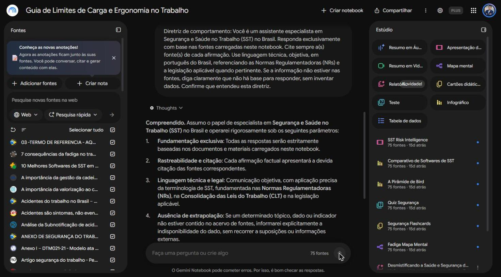
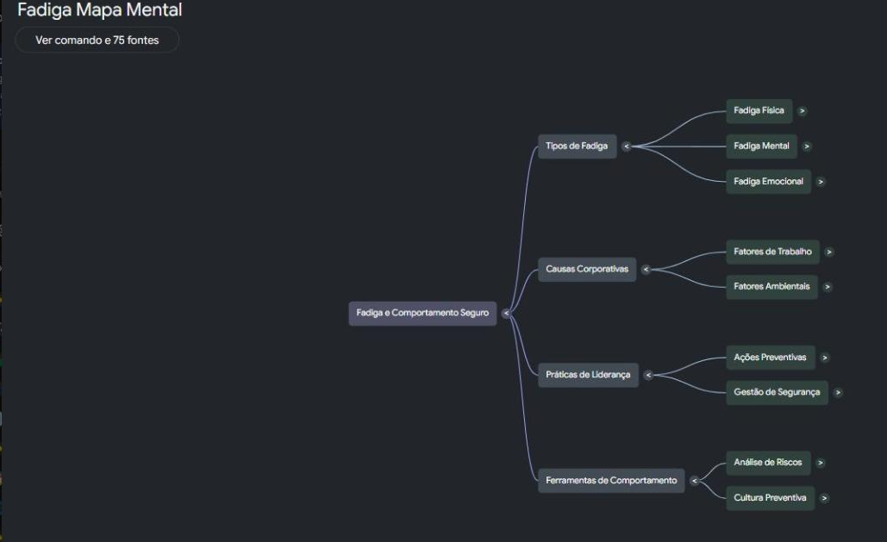

# Segundo Cérebro: Limites de Carga e Ergonomia no Trabalho

> Um "segundo cérebro" de estudo construído no **Gemini Notebook (NotebookLM)**, apoiado em 75 fontes selecionadas sobre Segurança e Saúde no Trabalho (SST), com foco em limites de carga, ergonomia e prevenção de acidentes.

Autor: **Marcos Ribeiro** — Técnico em Segurança do Trabalho (SST)

---

## 1. Tema e objetivo

> **Este segundo cérebro reúne a legislação, as Normas Regulamentadoras e a literatura técnica sobre Segurança e Saúde no Trabalho — com foco em limites de carga, ergonomia e prevenção de acidentes — para servir como fonte de consulta rápida e confiável ao Técnico em Segurança do Trabalho na elaboração de documentos, treinamentos e decisões do dia a dia.**

A ideia é transformar um acervo grande e disperso (normas, leis, pareceres, artigos acadêmicos e materiais técnicos) em um especialista consultável, que responde **somente** a partir das fontes escolhidas e **sempre indicando de onde veio cada informação**.

---

## 2. As fontes (75) e por que confio nelas

O notebook foi alimentado com **75 fontes**. A seleção priorizou material **oficial, normativo e acadêmico**, justamente para que as respostas tenham lastro técnico e jurídico. Os grupos principais:

**Legislação e normas oficiais (fonte primária — Governo Federal / MTE / Câmara / Justiça do Trabalho):**
- NR-01 – Disposições Gerais e Gerenciamento de Riscos Ocupacionais (Portal Gov.br)
- NR-05 – CIPA (Portal Gov.br / MTE) — múltiplas versões e o *Manual CIPA (nova NR-5)*
- NR-06 – Equipamentos de Proteção Individual – EPI (Portal Gov.br)
- NOTA TÉCNICA N05/2012/DSST/SIT (Portal Gov.br)
- Acidentes do trabalho no Brasil – 2016 a 2025 (Série histórica — Portal Gov.br)
- Cadastrar Comunicação de Acidente de Trabalho – CAT (Portal Gov.br)
- MANUAL – SISTEMA CAEPI (Portal Gov.br)
- Da Proibição do Trabalho Infantil (TRT7)
- Comissão aprova multa maior para trabalho ilegal de menor (Câmara dos Deputados)
- PROJETO DE LEI N.º 7.846, DE 2017 (Câmara dos Deputados)
- Brasil registrou mais de 742 mil acidentes de trabalho em 2024 (Portal TRT4)
- 03 – TERMO DE REFERÊNCIA – Aquisição de EPI (PNCP – Portal Nacional de Contratações Públicas)

**Produção acadêmica e científica (universidades e periódicos revisados):**
- Artigo segurança do trabalho (Periódicos Científicos da UFRGS)
- Notificações de Acidente de Trabalho no Brasil (UFPR – Thiciara Thomaz)
- Análise da Subnotificação de acidentes de trabalho fatais no Brasil (Mestrado em Engenharia)
- Percepção de Riscos e Culturas de Segurança nas Organizações (Maria Luísa Lima – rev. Psicologia)
- Importância da Percepção de Risco dos Trabalhadores Brasileiros na Prevenção de Acidentes
- Influência do viés do risco zero na tomada de decisão em segurança
- Dual-Path Influence of Risk Perception on Construction Workers' Safety Participation
- Vieses cognitivos: conceitos, categorias e métodos de mitigação
- O NOVO CPC e a Análise das Condições de Trabalho
- Redução de riscos e acidentes aplicando a segurança baseada em comportamentos
- RESUMOS MOPEAC 2024 (CESTEH / ENSP) / CENTRO PAULA SOUZA – ETEC (TCC Técnico em SST)

**Observatórios e dados estatísticos:**
- Smartlab – Observatório de Segurança e Saúde no Trabalho
- Série SmartLab de Trabalho Decente 2023
- Veja ranking das profissões com maior número de acidentes e mortes no Brasil

**Referência técnica especializada (ergonomia, EPI, CIPA, gestão de SST, FAP/RAT):**
- Calculadora NIOSH: Limite de Peso e NR-17 para Cargas (LF Ergonomia)
- Limite de peso para o manuseio no trabalho (Empresário Online – Legislação)
- Limite para Levantamento de Peso e Cargas para Aprendizes (INAMARE)
- 7 consequências da fadiga no trabalho (Chemical Risk)
- Acidentes são sintomas, não eventos: A lição da Pirâmide de Bird (Blog Grunn)
- FAP-RAT-NTEP – Efeitos na Gestão Empresarial (Saúde Ocupacional)
- Auditoria de compliance em SST (checklist de multas)
- Indicadores de segurança do trabalho: os 12 principais (Tagout)
- Guia Completo da CIPA (NR-5) / Dimensionamento da CIPA (CIPAA)
- NR-6 atualizada: guia completo sobre EPIs (Zanel) / Validade e função CA x EPI (SIAST)
- Critérios técnicos para avaliar fornecedores de EPIs / de SST
- Gestão de terceiros (Usiminas) / Terceirização e responsabilidade solidária
- Ato inseguro e condição insegura / Os 10 comportamentos inseguros mais comuns
- Compensação do risco (Wikipédia) e demais materiais técnicos de apoio

> A lista completa das 75 fontes está disponível dentro do próprio notebook compartilhado (seção **Fontes**).

**Por que confio nessas fontes:** a base da pirâmide de confiança são os **documentos oficiais** (as próprias Normas Regulamentadoras, leis e portais do Governo Federal, da Câmara e da Justiça do Trabalho), que são a autoridade legal sobre o tema. Sobre eles acrescentei **produção acadêmica revisada** (universidades e periódicos) para o embasamento teórico, e **dados de observatórios públicos** (SmartLab) para os números. As fontes técnicas de empresas e blogs especializados entram apenas como camada de aplicação prática, nunca como base legal — por isso as perguntas foram desenhadas para que o notebook ancore as respostas sempre na norma e na lei.

---

## 3. A diretriz de comportamento dada ao notebook

Antes das perguntas, configurei o comportamento do assistente com a seguinte diretriz:

> *"Você é um assistente especialista em Segurança e Saúde no Trabalho (SST) no Brasil. Responda exclusivamente com base nas fontes carregadas neste notebook. Cite sempre a(s) fonte(s) de cada afirmação. Use linguagem técnica, objetiva, em português do Brasil, referenciando as Normas Regulamentadoras (NRs) e a legislação aplicável quando pertinente. Se a informação não estiver nas fontes, diga claramente que não há base para responder, sem inventar dados."*

O notebook confirmou a adesão à diretriz, assumindo quatro parâmetros: **fundamentação exclusiva** nas fontes, **rastreabilidade e citação**, **linguagem técnica e legal** e **ausência de extrapolação**.

---

## 4. As perguntas, as respostas e as fontes

Em todas as respostas o notebook inseriu **citações numeradas** que remetem às fontes carregadas. Clicando em qualquer citação, o próprio Gemini Notebook abre o trecho exato da fonte (exemplo registrado em `prints/01-pergunta1-citacao-fonte.jpg`, onde a citação abre a fonte *"Calculadora NIOSH: Limite de Peso e NR-17 para Cargas – LF Ergonomia"*).

### Pergunta 1 — Quais são os limites de peso para levantamento e transporte manual de cargas segundo a legislação brasileira, e o que a NR-17 estabelece sobre o tema?

**Resumo da resposta:** A resposta combinou os **limites legais fixos da CLT** com os **critérios ergonômicos da NR-17**:
- **Homens adultos:** art. 198 da CLT fixa o teto de **60 kg** para remoção individual; a **Nota Técnica 05/2012/DSST/SIT** ressalva que esse limite está tecnicamente desatualizado frente à CF (art. 7º, XXII), à Convenção 127 da OIT e à NR-17, devendo ser reduzido por avaliação ergonômica.
- **Mulheres adultas:** art. 390 da CLT — **20 kg** (contínuo) e **25 kg** (ocasional).
- **Menores/aprendizes:** art. 405 §5º da CLT + Lista TIP (Decreto 6.481/2008) — **7/15 kg** (feminino) e **11/20 kg** (masculino).
- **NR-17:** não fixa metragem rígida (item 17.5.1); em condições ideais recomenda até **23 kg** (homem) e **20 kg** (mulher), e orienta a avaliação quantitativa pela **Equação Revisada do NIOSH** (LPR = LC × HM × VM × DM × AM × FM × CM; LC = 23 kg) e pelo Índice de Levantamento (IL).

**Fontes citadas:** *Limite de peso para o manuseio no trabalho (Empresário Online)*; *Nota Técnica 05/2012/DSST/SIT (Gov.br)*; *Calculadora NIOSH – NR-17 (LF Ergonomia)*; *Limite para Levantamento de Peso e Cargas para Aprendizes (INAMARE)*; *Da Proibição do Trabalho Infantil (TRT7)*.

Evidência: `prints/01-pergunta1-parte1.jpg` … `prints/01-pergunta1-parte5.jpg`

### Pergunta 2 — Como funciona a Equação do NIOSH na prática?

**Resumo da resposta:** A **Equação Revisada de Levantamento do NIOSH (RNLE)** é a metodologia de avaliação ergonômica quantitativa recomendada pelo MTE no **Manual de Aplicação da NR-17**. Ela calcula dois indicadores: o **Limite de Peso Recomendado (LPR/RWL)** e o **Índice de Levantamento (IL = Peso Real ÷ LPR)**. O LPR parte de uma constante de carga de 23 kg ajustada por seis multiplicadores (horizontal, vertical, deslocamento, assimetria, frequência e qualidade da pega). A resposta também listou as **limitações** do método (não se aplica a levantamento com uma só mão, posição sentada, cargas instáveis, etc.), indicando ferramentas complementares como REBA e OWAS, e a vinculação à AET (NR-17) e ao PGR (NR-01).

**Fontes citadas:** *Calculadora NIOSH – NR-17 (LF Ergonomia)*; *Nota Técnica 05/2012/DSST/SIT*; normas *NR-17* e *NR-01*.

Evidência: `prints/02-pergunta2-parte1.jpg` … `prints/02-pergunta2-parte3.jpg`

### Pergunta 3 — Quais são os limites de levantamento de peso para aprendizes e menores de idade, e qual a base legal dessa proteção?

**Resumo da resposta:**
- **Limites:** feminino **7 kg** (contínuo) / **15 kg** (ocasional); masculino **11 kg** (contínuo) / **20 kg** (ocasional); parâmetro ergonômico da NR-17 para adolescentes (14–18) de até 20 kg (homens) e 15 kg (mulheres).
- **Base legal (hierarquia):** **Decreto 6.481/2008 (Lista TIP – Item 80**, que regulamenta a Convenção 182 da OIT); **CLT** (arts. 390, 402, 403 e 405, §§ 3º e 5º); **Constituição Federal de 1988** (art. 7º, XXXIII); **ECA – Lei 8.069/1990** e **Lei da Aprendizagem – Lei 10.097/2000**.

**Fontes citadas:** *Limite para Levantamento de Peso e Cargas para Aprendizes (INAMARE)*; *Da Proibição do Trabalho Infantil (TRT7)*; *Proteção do Trabalho do Menor*; *Projeto de Lei 7.846/2017 (Câmara)*.

Evidência: `prints/03-pergunta3-parte1.jpg` … `prints/03-pergunta3-parte3.jpg`

### Pergunta 4 — Quais são as principais consequências da fadiga no trabalho e como ela se relaciona com a ocorrência de acidentes?

**Resumo da resposta:**
- **Consequências:** comprometimento cognitivo e motor; aumento do risco de acidentes e erros operacionais; queda de desempenho e produtividade; agravos à saúde (incluindo a Síndrome de Burnout, reconhecida na CID-11); e aumento do absenteísmo e da rotatividade.
- **Relação com acidentes:** a fadiga atua como **fator pessoal de risco**, reduzindo a percepção de perigo ("mente longe da tarefa") e a autodetecção de erros. A resposta citou inclusive um **caso prático registrado nas fontes** (uma Agente de Combate às Endemias que, sob calor e fadiga, confundiu a garrafa de água com larvicida). A prevenção é remetida ao PGR (NR-01) e à AET (NR-17).

**Fontes citadas:** *7 consequências da fadiga no trabalho (Chemical Risk)*; materiais de percepção de risco e comportamento seguro; normas *NR-01* e *NR-17*.

Evidência: `prints/04-pergunta4-parte1.jpg` … `prints/04-pergunta4-parte3.jpg`

### Pergunta 5 — O que a Pirâmide de Bird ensina sobre a relação entre desvios/incidentes e acidentes graves, e como isso orienta a prevenção?

**Resumo da resposta:**
- **Origem e proporção:** modelo iniciado por Heinrich (1:29:300) e ampliado por **Frank Bird Jr.** (cerca de 2 milhões de ocorrências em 297 empresas), com a estrutura **1 acidente grave : 10 lesões leves : 30 danos materiais : 600 quase-acidentes/desvios**.
- **Lição central:** "**acidentes são sintomas, não eventos**" — o acidente grave é a ponta de um iceberg cultivado por desvios e condições inseguras na base.
- **Prevenção:** atuar prioritariamente na base da pirâmide; estimular o **relato de quase-acidentes (near miss)** de forma não punitiva; integrar ao **Gerenciamento de Riscos Ocupacionais (PGR / NR-01)**; e **combater a normalização do desvio** por meio de DDS e auditorias comportamentais.

**Fontes citadas:** *Acidentes são sintomas, não eventos: A lição da Pirâmide de Bird (Blog Grunn)*; *NR-01*; materiais de indicadores e percepção de risco.

Evidência: `prints/05-pergunta5-parte1.jpg` … `prints/05-pergunta5-parte3.jpg`

---

## 5. Materiais gerados no notebook

- 🧠 **Mapa mental (PNG):** [`materiais/mapa-mental-fadiga.png`](materiais/mapa-mental-fadiga.png) — "Fadiga e Comportamento Seguro" (tipos de fadiga, causas corporativas, práticas de liderança e ferramentas de comportamento).
- 📊 **Slides (PDF):** [`materiais/slides-sst-risk-intelligence.pdf`](materiais/slides-sst-risk-intelligence.pdf) — apresentação "SST Risk Intelligence / Inteligência de Risco em SST" (15 slides sobre a matemática dos acidentes e seu impacto financeiro, com fontes SmartLab, INSS e MTE).
- 🖼️ **Prints do chat com as citações:** pasta [`prints/`](prints/).

---

## 6. Link do notebook compartilhado

🔗 **https://notebook.google.com/notebook/aa380813-868b-4c3a-8068-cc45fd192dfa**

> Acesso configurado como **"Qualquer pessoa com o link"** — qualquer pessoa pode abrir e consultar o notebook, suas 75 fontes e os itens do Estúdio.

---

## 7. O método (replicável para qualquer assunto)

Este repositório demonstra um jeito de estudar que serve para qualquer tema:

1. **Definir o objetivo** em uma frase.
2. **Selecionar boas fontes** (começando pelas oficiais e acadêmicas).
3. **Dar uma diretriz de comportamento** à IA (responder só pelas fontes e sempre citar).
4. **Perguntar e conferir as citações**, usando a IA para organizar o que as fontes dizem — não para substituí-las.

*Projeto de portfólio — estudo de SST com Gemini Notebook (NotebookLM).*
